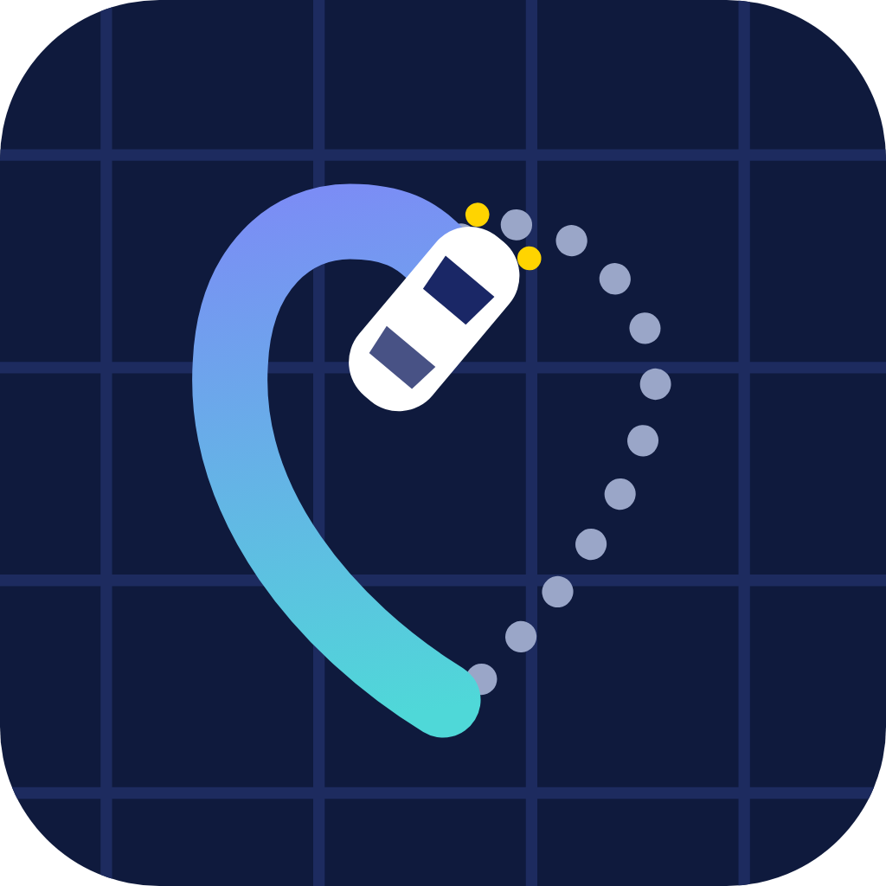
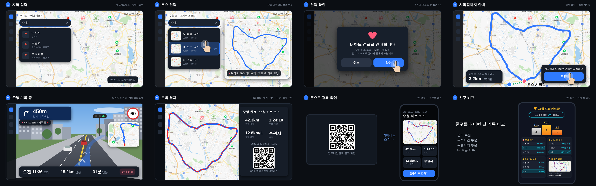
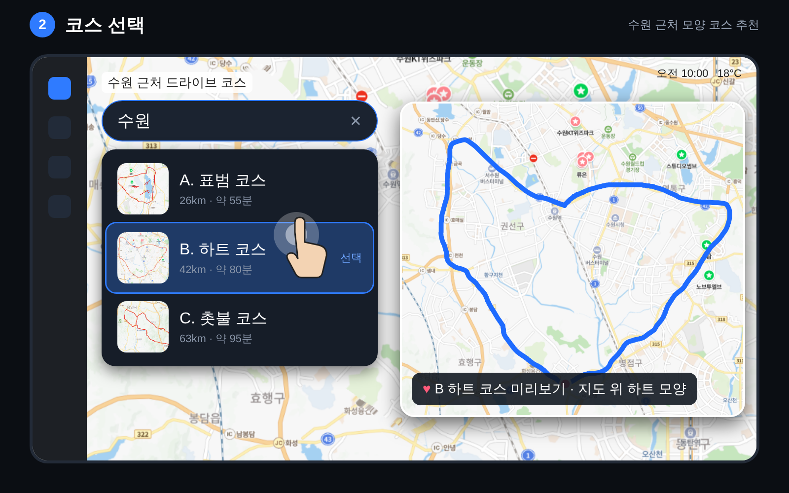
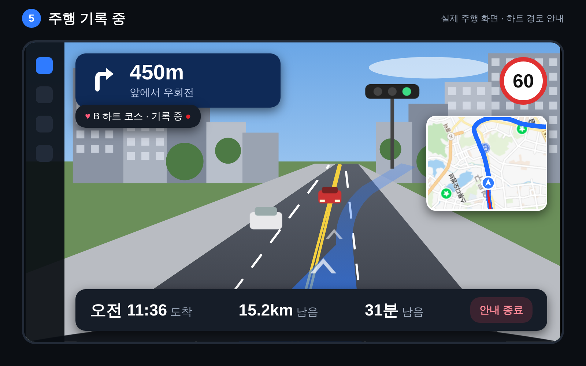
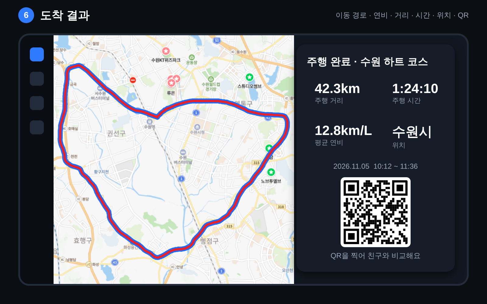
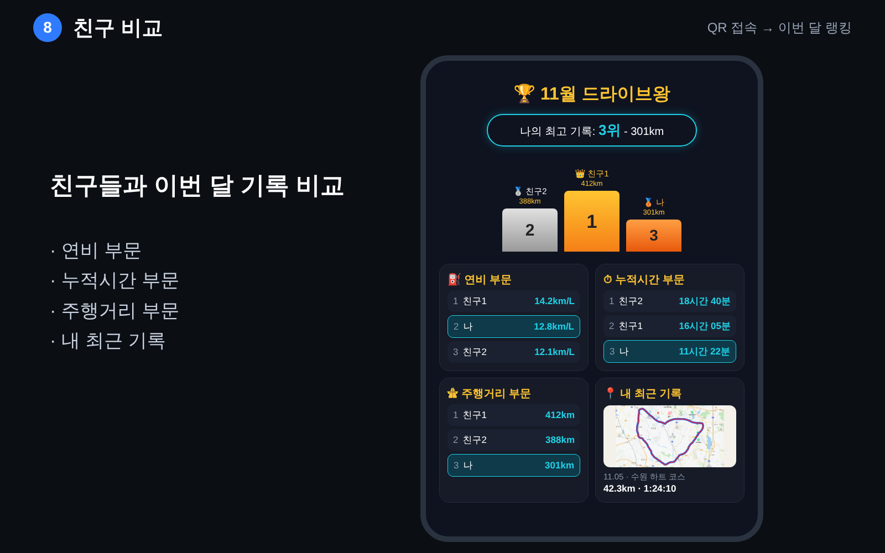

<p align="center">
  
</p>

<h1 align="center">IDID (I drive, I draw)</h1>

<p align="center">
  차 안에서 모양 코스를 골라 달리며 지도에 그림을 그리고,<br/>
  결과 QR로 친구와 기록을 비교하는 드라이브 앱
</p>

<p align="center">
  
</p>

차 인포테인먼트 화면에서 **지역별 드라이브 코스(하트, 고양이, 강아지 꼬리 모양 등)** 를 골라 달리고, 도착하면 결과 카드와 **QR** 로 주행 기록을 폰에서 확인·공유하는 앱이에요. Pleos 공모전 팀 프로젝트입니다.

> 현재 버전은 **시연(데모) 버전**이에요. 코스 안내 데이터와 가짜 주행 신호가 앱 안(`assets/demo`)에 들어 있어서, **서버나 인터넷 없이** 앱만 설치하면 처음부터 끝까지 한 바퀴를 체험할 수 있어요.

## 데이터 처리 원칙

**차량 데이터는 차량 내부에만 저장하고, 서버에는 지역명·모양 이름 같은 텍스트만 보냅니다. 음성 원문은 외부로 보내지 않습니다.**

- 서버는 지역·코스 텍스트를 받아 코스 JSON만 돌려줘요. 현재 위치, 주행 기록, 연비는 서버로 보내지 않아요.
- 주행 기록은 차 앱 안에만 남아요. 결과 QR에는 결과 요약을 주소의 `#` 뒤에 담아서, 웹 서버로 전송되지 않고 폰 브라우저 안에서만 풀려요.
- 친구 비교는 서버 대신 폰 브라우저에 모은 기록으로 계산해요. 자세한 흐름과 한계는 [시나리오 문서](docs/scenario-flow.md)의 2장, 6장, 7장에 있어요.

## 데모 화면

<p align="center">
  
  
  
  
</p>

<p align="center"><sub>코스 선택 · 주행 기록 · 결과 QR · 친구 비교 (전체 8장: <a href="docs/ui/">docs/ui/</a>)</sub></p>

## 데모 흐름 (수원 하트 코스)

IDID(I drive, I draw)는 차량 인포테인먼트에서 지역과 모양 코스를 고르고, 달리며 지도에 그림을 그리고, 도착 후 결과 QR로 친구와 기록을 비교하는 서비스입니다.

1. **지역 입력**: 인포테인먼트가 "어디로 가시겠어요?"라고 묻고, 운전자가 "수원"이라고 말합니다. 음성은 차 안에서 글자로 바꾸고, 음성 원문은 밖으로 보내지 않습니다(데모는 터치 입력).
2. **코스 선택**: 수원 근처 모양 코스(표범, 하트, 촛불)가 지도 위 미리보기와 함께 나오고, 운전자가 "하트 코스"를 고릅니다.
3. **코스 받기**: 선택한 지역과 코스 이름(텍스트)만 FastAPI 서버에 보내고, 서버가 DB의 프리셋 코스로 경로·모양 데이터(코스 JSON)를 응답합니다. 현재 위치는 보내지 않습니다. (서버는 설계 단계라, 지금 데모는 앱 안의 코스 데이터를 씁니다.)
4. **시작점까지 안내**: 확인을 누르면 코스 시작점까지 안내합니다(NaviHelper SDK).
5. **주행 기록**: 코스에 처음 진입하면 기록이 시작됩니다. 이동 경로, 평균 연비, 주행 시간, 거리를 차 안에 저장합니다(NaviHelper, FusedLocation, Vehicle SDK).
6. **결과 화면**: 도착하면 지도 위에 그려진 경로와 연비, 거리, 시간이 나오고 결과 QR이 표시됩니다. 기록은 서버로 보내지 않고, 결과 요약을 QR 주소 안(`#` 뒤)에 담습니다.
7. **내 결과 확인**: 스마트폰으로 QR을 찍으면 내 결과 페이지(거리, 시간, 연비, 경로)가 열립니다. 결과는 폰 브라우저 안에서만 풀어서 보여 주고 폰에 보관합니다.
8. **친구 비교**: 친구에게 받은 결과 링크를 폰에 모아 "11월 드라이브왕" 화면에서 내 최고 기록과 1~3위 시상대, 연비·누적시간·주행거리 부문 순위, 내 최근 기록을 봅니다. 순위는 서버가 아니라 폰 브라우저가 계산합니다.

## 구성

| 구성요소 | 역할 |
|---|---|
| 인포테인먼트 (Pleos 앱) | 지역 입력, 코스 선택, 안내, 주행 기록, 결과 QR |
| 운전자 휴대폰 (웹) | QR 결과 풀기·확인, 받은 기록 보관(브라우저 저장소), 친구 비교·랭킹 계산 |
| FastAPI 서버 | (설계 단계, 이번 데모에는 미포함) 지역·코스 텍스트를 받아 코스 JSON 응답. 주행 기록은 받지 않음 |
| DB | (설계 단계) 프리셋 코스만. 주행 기록·사용자 정보는 저장하지 않음 |

> 지금 저장소에서 코드가 있는 부분은 인포테인먼트 앱(`android/`)뿐이에요. 데모 코스는 앱 안(`android/app/src/main/assets/demo`)에 들어 있어요.

## 준비물

| 항목 | 버전 |
|---|---|
| Android Studio | **Ladybug (2024.2.1) 이상** (AGP 8.7.3을 쓰기 때문이에요) |
| JDK | 17 (Android Studio 내장 JDK 사용 가능) |
| Android SDK | SDK Platform **API 34** (compileSdk / targetSdk 34, minSdk 28) |
| Gradle | 8.9 (프로젝트의 `gradlew`가 알아서 내려받아요) |
| Pleos Vehicle SDK | 2.3.2 (`ai.pleos.playground:Vehicle`, Gradle이 자동으로 받아요) |
| 에뮬레이터 | **Pleos Connect Emulator** (API 34, Automotive). 시스템 이미지 URL은 공모전·Pleos 측에서 따로 받아요 |
| Python | 3.8 이상 (선택: 시연 데이터를 새로 만들 때만, 표준 라이브러리만 써요) |

> 처음 빌드할 때 Gradle과 라이브러리를 내려받으니 **인터넷 연결**이 필요해요. Pleos Vehicle SDK는 `nexus-playground.pleos.ai` 저장소에서 받아요 (`android/settings.gradle.kts`에 이미 설정되어 있어요).
>
> Vehicle SDK는 신청서에 적은 **2.3.1** 기준으로 시작했고, 이후 Pleos 문서의 최신 버전인 **2.3.2**로 올렸어요.
>
> **API 키나 `.env` 설정 없이** 빌드·실행돼요. 결과 QR을 폰에서 열 때만 `android/local.properties`에 `pleos.webUrl`을 넣어요(아래 "결과 QR 설정").

## 제출 APK (바로 설치해서 테스트하기)

소스를 빌드하지 않고 바로 설치해 보려면 release APK를 그대로 쓰면 돼요.

- **APK 파일 위치**: [`apk/I_Drive_I_Draw_IDID_release.apk`](apk/I_Drive_I_Draw_IDID_release.apk)
- **개발에 사용한 Pleos Connect 에뮬레이터**: Pleos Connect v2.1.0 (API 34, Automotive)
- **화면 규격**: 2560 × 1440, 160dpi (Pleos Connect v2.1.0 기본 스킨)

```bash
adb install -r apk/I_Drive_I_Draw_IDID_release.apk
```

## 실행 방법

### 1. 내려받기

```bash
git clone https://github.com/Nana2828/Pleos_application.git
cd Pleos_application
```

> 저장소가 비공개일 때는 초대받은 GitHub 계정으로만 받을 수 있어요.

### 2. Android Studio에서 열기

**File → Open** 에서 저장소 전체가 아니라 **`android/` 폴더** 를 선택해요. (Gradle 프로젝트가 `android/` 안에 있어요.) 열면 Gradle Sync가 자동으로 시작돼요. 끝날 때까지 기다려 주세요.

### 3. Pleos Connect Emulator 준비

Pleos 공식 문서([Getting Started](https://document.pleos.ai/docs/pleos-only/getting-started))의 안내에 따라 설치해요.

1. **Tools → SDK Manager → SDK Update Sites** 에서 공모전·Pleos 측에서 받은 Pleos Connect 시스템 이미지 URL을 추가해요.
2. **SDK Platforms** 에서 API 34용 Pleos Connect 시스템 이미지를 설치하고 Android Studio를 다시 시작해요.
3. **Tools → Device Manager → Create device → Automotive → Pleos Connect** 를 고르고, RAM 4 GB, Boot option **Cold boot** 로 만들어 실행해요.

에뮬레이터가 켜져 있으면 Android Studio 상단의 기기 목록에 나타나요.

### 4. 앱 실행

Android Studio에서 기기를 에뮬레이터로 고르고 ▶ **Run** 을 누르면 돼요. 명령줄로 하려면:

```bash
cd android
./gradlew installDebug      # 켜져 있는 에뮬레이터에 설치
./gradlew assembleDebug     # APK만 만들기: app/build/outputs/apk/debug/app-debug.apk
```

Windows는 `./gradlew` 대신 `gradlew.bat` 을 써요.

### 5. 테스트 (선택)

```bash
cd android
./gradlew test
```

주행 계산, 코스 매칭, 안내, 화면 상태 로직에 대한 단위 테스트가 들어 있어요.

## 결과 QR 설정 (선택)

앱만 실행해도 코스 주행까지는 모두 동작해요. 결과 화면의 QR이 **폰 웹 페이지** 를 열도록 하려면 폰 웹 서버 주소를 알려줘야 해요.

1. 폰 웹 서버를 노트북에서 실행해요. 폰 웹(`web/drive-run-web`)은 이 저장소에 아직 포함되어 있지 않을 수 있으니 팀의 웹 담당에게 받아 주세요. 실행하면 `Wi-Fi: http://192.168.x.x:5173` 같은 주소가 나와요.
2. `android/local.properties` 파일에 아래 한 줄을 추가해요. (git에 올라가지 않는 파일이에요.)
   ```properties
   pleos.webUrl=http://192.168.x.x:5173/
   ```
3. 다시 빌드·설치해요: `./gradlew installDebug`
   (한 번만 다른 주소로 빌드하려면 `./gradlew installDebug -Ppleos.webUrl=http://...`)

주의할 점:
- 폰과 노트북이 **같은 와이파이** 에 있어야 QR이 열려요.
- 와이파이가 바뀌면 노트북 IP도 바뀌니 2번 값을 고치고 다시 빌드해요.
- 값이 없거나 형식이 틀리면(`http://` 누락, `?`·`#` 포함) QR 자리에 "웹 주소가 설정되지 않았어요"가 표시돼요. 이때도 앱의 나머지 기능은 정상 동작해요.

## 문제 해결

| 증상 | 해결 |
|---|---|
| Windows에서 사용자 폴더 이름이 한글이라 빌드 실패 | 환경 변수로 영문 경로를 지정해요. `GRADLE_USER_HOME=C:/Android/.gradle`, `PLEOS_BUILD_DIR=C:/Android/build/pleos-drive` (이때 APK는 `PLEOS_BUILD_DIR` 아래에 생겨요) |
| Gradle Sync에서 `ai.pleos.playground:Vehicle` 을 못 찾음 | 인터넷 연결과 사내망/방화벽에서 `nexus-playground.pleos.ai` 접근이 막혀 있지 않은지 확인해요 |
| `pleos.webUrl 이 없어요` 경고 | QR 설정을 하지 않았다는 안내예요. QR을 쓰지 않으면 무시해도 돼요 |
| JDK 관련 오류 | Android Studio → Settings → Build Tools → Gradle → Gradle JDK 를 17로 맞춰요 |

## 폴더 구조

```
Pleos_application/
├── android/     인포 앱 (Kotlin, Jetpack Compose, MVVM)  ← 지금 실행하는 부분
│   ├── app/src/main/java/ai/pleosapp/drive/
│   │   ├── core/    주행 계산, 코스 목록, 코스 매칭, 내비 안내, 가짜 주행 재생
│   │   └── ui/      화면(지역·미리보기·길이·확인·시작점 안내·주행·결과·시연 도구)과 화면 상태
│   ├── app/src/main/assets/demo/   시연용 코스 · 경로 · 주행 신호 데이터
│   └── tools/demo/                 시연 데이터를 만드는 Python 스크립트
├── server/      API 서버 (FastAPI) — 설계 문서(README)만, 구현 예정
├── simulator/   가상주행 — 설계 문서만 (시연용 주행 신호는 android/tools/demo 에서 만들어요)
├── data/        경로 프리셋, 코스 DB — 설계 문서만 (데모 코스는 assets/demo 에 있어요)
├── web/         폰 웹 (결과, 친구 비교, QR) — 설계 문서만, 웹 담당이 따로 관리
├── shared/      공유 JSON 규격 — 설계 문서만
└── docs/        기획, 시나리오, 역할, UI 시안
```

## 기술 스택

Kotlin 2.0.21 · Jetpack Compose (BOM 2024.12.01, Material3) · MVVM (ViewModel + StateFlow) · kotlinx.serialization · ZXing(QR) · Pleos Vehicle SDK 2.3.2 · AGP 8.7.3

## 시연 데이터 만들기 (선택)

`android/tools/demo/build_demo_data.py` 가 코스 JSON을 받아 안내 경로와 가짜 주행 신호를 만들어요. OSRM 공개 서버를 호출하므로 인터넷이 필요하고, 앱 실행에는 필요하지 않아요.

```bash
python3 -I android/tools/demo/build_demo_data.py <코스 JSON> [--out <폴더>]
```

Windows는 `python3` 대신 `py -3` 을 써요.

## 더 알아보기

- 팀 규칙·브랜치·PR: [CONTRIBUTING.md](CONTRIBUTING.md)
- 역할 분담: [docs/team-roles.md](docs/team-roles.md)
- 시나리오: [docs/scenario-flow.md](docs/scenario-flow.md)
- 안드로이드 앱 상세: [android/README.md](android/README.md)
- 앱 아이콘 원본(낮·밤, PNG·SVG): [docs/icons/](docs/icons/)

## 출처

경로 안내 데이터: © OpenStreetMap contributors (ODbL), OSRM
