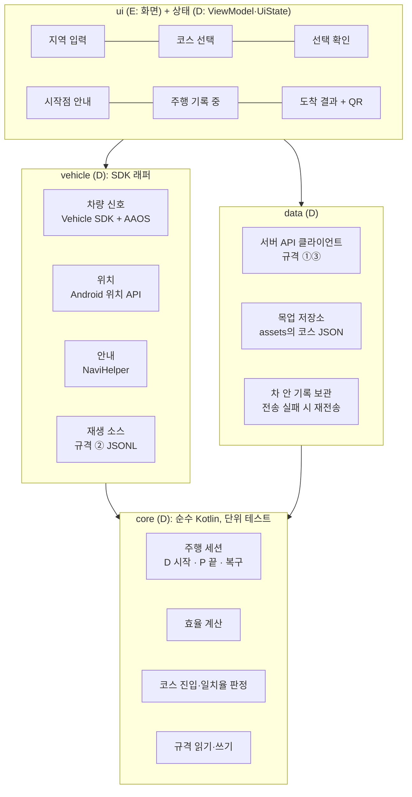

# 앱 코어 구조와 1차 시연 앱 계획 (D 제안)

> 💡 **회의 안건용 제안입니다.** 확정이 아니며, 회의에서 3장·5장·6장을 정하면 그대로 `app/`을 만듭니다.
> 작성 2026-11-08 · D · 근거: `docs/scenario-flow.md`, `docs/team-roles.md`, `docs/data-contracts.md`, `docs/AI_CONTEXT_D.md`

## 1. 한눈에

- **`app/`은 안드로이드 모듈 하나로 둡니다.** 그 안을 패키지 4개(`core`, `vehicle`, `data`, `ui`)로 나눕니다. 모듈을 여러 개로 나누는 것보다 마감 전에 빠릅니다.
- **D와 E는 "화면 상태(UiState)"를 경계로 나눕니다.** 화면마다 보여 줄 값과 버튼 동작을 미리 정해 두면, 서로의 파일을 고치지 않아도 합쳐집니다. ViewModel을 D와 E 중 누가 맡을지는 두 안이 있습니다(4장).
- **11-15 접수 때 가산점용 시연 앱을 내는 것**을 제안합니다. 서버 없이 목업 데이터로 "코스 선택 → 안내 → 가상주행 → 결과" 한 바퀴만 동작하게 만듭니다.

## 2. 왜 이 구조인가

| 원칙 | 이유 |
|---|---|
| SDK는 래퍼 뒤에 둠 | 에뮬레이터에서 안 되는 값(연비 등)이 많음. 실제 구현과 가짜(재생·목업) 구현을 바꿔 끼워야 시연이 흔들리지 않음 |
| 계산은 안드로이드와 분리 (`core`) | 주행 세션·효율·코스 진입 판정을 PC에서 단위 테스트로 검증. 이전 시험 앱의 테스트 89개와 이번 7개를 그대로 옮길 수 있음 |
| 서버는 규격 뒤에 둠 (`data`) | C의 서버가 준비되기 전에는 같은 규격의 목업으로 개발. 규격만 같으면 나중에 주소만 바꿈 |
| D·E 경계는 상태 객체 | 화면 디자인을 바꿔도 D 코드는 그대로, 계산을 바꿔도 E 코드는 그대로 |

## 3. 폴더 구조 (제안)



```
app/src/main/java/<패키지>/          ← 패키지 이름은 앱 이름 확정 후 (⬜ 합의 필요)
├── core/        모델(Course, DriveRecord, DriveSignal), DriveSession, Efficiency, CourseMatcher, 규격 코덱
├── vehicle/     VehicleSignalSource(실차) · ReplaySource(재생) · LocationSource · NaviGateway
├── data/        CourseRepository(서버 | 목업) · DriveUploader · LocalDriveStore
└── ui/
    ├── state/   화면별 UiState와 ViewModel  ← D
    └── screen/  Compose 화면, 테마, 문구      ← E
```

## 4. D와 E가 주고받는 것 (제안)

UI 카드 8장(`docs/ui/`) 중 인포 화면 1~6번 기준입니다. 7~8번은 폰 웹이라 E와 C가 맡습니다.

| # | 화면 | D가 주는 상태 (예) | E가 부르는 동작 (예) |
|---|---|---|---|
| 1 | 지역 입력 | 입력 가능한 지역 목록, 불러오는 중 여부 | `onRegionSelected(region)` |
| 2 | 코스 선택 | 코스 목록(이름, 라벨, 모양 미리보기 좌표, 거리, 예상 시간) | `onCourseSelected(courseId)` |
| 3 | 선택 확인 | 고른 코스, 안내 시작 가능 여부 | `onStartGuidance()` |
| 4 | 시작점 안내 | 출발점까지 거리, 안내 상태 | `onCancel()` |
| 5 | 주행 기록 중 | 기록 여부, 경과 시간, 거리 (**주행 중이라 숫자 2~3개만**) | 없음. 터치 조작 없음 |
| 6 | 도착 결과 | 거리, 시간, 평균 효율과 출처, 궤적 좌표, 코스 일치율, QR용 `result_url`, 전송 상태 | `onRetryUpload()`, `onDone()` |

**경계를 어디에 둘지 두 안이 있습니다.** `team-roles.md`는 E 항목에 "MVVM + ViewModel + StateFlow"를 적어 두었습니다.

| 안 | D | E | 장단점 |
|---|---|---|---|
| 가 (위 표) | ViewModel·UiState까지 | Compose 화면·테마·문구 | E는 화면에만 집중. D 일이 늘어남 |
| 나 (역할표대로) | 저장소·SDK 래퍼·계산(`core`, `vehicle`, `data`) | ViewModel·UiState·화면 | 역할표와 같음. E가 D의 함수를 직접 부름 |

- 5번 화면은 주행 중 화면이라 버튼과 긴 글을 두지 않습니다. 기록은 기어 D·P와 코스 진입으로 자동 시작·종료합니다.
- 효율 표기 단어("연비", "효율", "전비")는 ⬜ 합의 필요입니다. 상태에는 값과 단위만 넣고, 문구는 E가 정합니다.

## 5. 데모 모드 (제안)

설정 하나로 실제 경로와 시연 경로를 바꿉니다. 코드 경로는 같습니다.

| 부분 | 실제 | 데모 |
|---|---|---|
| 코스 | C 서버 `GET /courses` | 앱 안 목업 코스 JSON (규격 ①) |
| 주행 신호 | 차량 SDK·위치 | 가상 콘솔 주행(`console_drive.py`) 또는 JSONL 재생 |
| 결과 전송 | `POST /drive` | 전송 생략, 목업 `result_url` |

## 6. 1차 시연 앱 (11-15 접수, 가산점) 제안

**목표:** 시연 영상과 APK를 낼 수 있는 한 바퀴. 기획서만 내는 것보다 가산점을 받고, 2차 PT 앱의 뼈대가 됩니다.

| 넣는 것 | 빼는 것 (2차 PT까지) |
|---|---|
| 목업 코스 1~2개 → 코스 선택 → NaviHelper로 시작점 안내 | 실제 서버 연동 |
| 가상주행 → 코스 진입 시 자동 기록 → 도착 결과(거리·시간·효율·궤적) | 폰 웹 친구 비교·랭킹 |
| 결과 QR (목업 주소) | 음성 입력·안내 (SDK 준비 중) |

**일정 (제안, 7일):**

| 날짜 | 할 일 | 누가 |
|---|---|---|
| 11-09 | 구조 합의, `app/` 뼈대와 빌드 | D |
| 11-09~11-10 | `core` 이전(세션·효율·진입 판정), 목업 코스 | D (코스 모양은 B와 상의) |
| 11-10~11-12 | 화면 1~6 최소 구현 | E (D는 상태 제공) |
| 11-12~11-13 | 한 바퀴 연결, 에뮬레이터 시험 | D·E |
| 11-13 | 시연 영상 녹화 | A (시나리오), D (조작) |
| 11-14 | 제출용 익명 저장소·APK 정리 | A·D |
| 11-15 | 접수 마감 23:59 | A |

**다른 역할에 부탁할 것 (제안):** B는 시연 코스 1개의 모양과 경유지를 맡아 주세요(없으면 D가 목업으로 만듭니다). E는 화면 2·6번을 우선 만들어 주세요. A는 영상 순서를 짜 주세요. C는 1차에는 할 일이 없고, 2차를 위해 규격 ①③으로 서버를 준비해 주세요.

**알려진 위험:**
- 에뮬레이터 내비는 GPS를 따라 움직이지 않습니다. 영상에서 내비 화면은 "안내 시작"까지만 보여 주고, 기록·결과는 앱 화면으로 보여 줍니다.
- 에뮬레이터 차가 전기차라 효율은 km/kWh로 나옵니다(표기 안건 참고).
- 제출 저장소와 영상에는 이름·계정이 드러나면 안 됩니다(익명성 규정). 이 작업 저장소는 그대로 내지 않습니다.

## 7. 회의에서 정할 것

| # | 안건 | D 제안 |
|---|---|---|
| 1 | `app/` 구조 | 모듈 1개 + 패키지 4개 (3장) |
| 2 | D·E 경계 | 가안(D가 ViewModel까지)과 나안(역할표대로 E가 ViewModel) 중 선택 (4장). E의 Kotlin 경험에 따라 정함 |
| 3 | 1차에 시연 앱을 낼지와 범위 | 낸다. 6장 범위 |
| 4 | 앱 이름·패키지 이름 | 이름이 정해져야 패키지를 만들 수 있음 |
