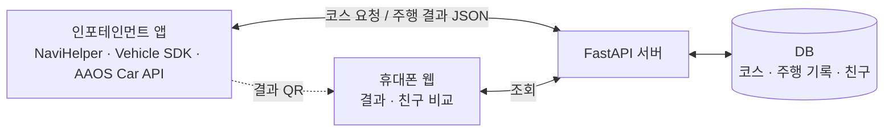

# 기획서 기술 파트 초안 (D)

> **받는 사람:** A (기획서 취합 담당)
> **상태:** D 초안, 팀 검토 전. 확정된 문구가 아닙니다. `💡 제안`과 `⬜ 합의 필요` 표시는 회의에서 정한 뒤 지워 주세요.
> **기준 시점:** 2026-11-08. 근거는 `docs/scenario-flow.md`, `docs/data-contracts.md`, `spikes/vehicle-probe/README.md`(브랜치 `feature/d-vehicle-probe`), 이전 시험 앱 인계 문서입니다.
>
> | 이 문서의 장 | 접수양식 02장 어디에 들어가나 |
> |---|---|
> | 1. 사용 SDK·API와 쓰임새 | **5번 개발 계획** SDK 표 + **3번** "차량 특화 요소" 열 |
> | 2. 시스템 구성 | **5번** 구현 방식(아키텍처 요약) |
> | 3. 기술적 검증 결과 | **5번** (근거 자료로 **7번 참고자료**에도 활용) |
> | 4. 제약과 대응 | **5번** "사용 불가 SDK에 의존하는 기능의 대응" |
> | 5. 개발 일정(기술) | **5번** 주요 개발 범위 (11/15, 12/03) |
> | 6. 주행 안전 설계 | **3번** "주행 중 주의 분산 방지 설계" |
>
> ⛔ 익명성: 이 초안에는 사람 이름·계정·저장소 주소를 넣지 않았습니다. 옮겨 적을 때도 넣지 않습니다.

---

## 1. 사용 SDK·API와 쓰임새

[앱 이름]은 Pleos Connect의 **NaviHelper SDK**와 **Vehicle SDK**를 핵심 기능에 씁니다. 속도·기어처럼 Pleos가 "표준 데이터"로 분류한 값은 Android Automotive(AAOS) 표준 Car API로 읽습니다.

### 1-1. 지금 쓰는 SDK·API

| 기능 | Pleos SDK / AAOS API | 권한 | 왜 차 안에서만 가능한가 |
|---|---|---|---|
| 코스 시작점까지 안내, 코스 경유지 안내 | **NaviHelper SDK** 3.0.5 — 목적지·경유지 경로 요청(`requestRouteWithWaypoints`), 경로 상태 이벤트(`NaviHelperEventListener`) | `NAVI_ROUTE`, `NAVI_ROUTE_SEARCH` (문서 기준) | 차에 탑재된 내비가 코스를 바로 안내합니다. 폰 앱을 따로 켜거나 거치할 필요가 없습니다. |
| 주행 거리 측정 | **Vehicle SDK** Odometer — 누적 주행거리 `getCurrentDistanceDriven`, 변화 이벤트 `registerDistanceDriven` | `pleos.car.permission.CAR_DRIVE` | GPS 추정이 아니라 **차가 직접 잰 주행거리**를 씁니다. |
| 평균 연비(전기차는 전비) | **Vehicle SDK** Fuel·EvBattery — 연비·전비 조회 (차가 주는 경우 우선 사용) | `pleos.car.permission.CAR_ENERGY` | 폰은 차의 연료·배터리 사용량을 알 수 없습니다. |
| 사용한 배터리 에너지 | **AAOS** `EV_BATTERY_LEVEL` (Wh) | `android.car.permission.CAR_ENERGY` (실행 중 요청) | 위와 같습니다. 연비를 직접 못 읽을 때 계산 근거가 됩니다. |
| 기록 자동 시작·종료 | **AAOS** `GEAR_SELECTION` (기어 P·R·N·D) | `CAR_POWERTRAIN` | 기어를 D로 넣으면 시작, P로 두면 끝납니다. 운전자는 버튼을 누르지 않습니다. 폰은 기어를 알 수 없습니다. |
| 속도 기록 | **AAOS** `PERF_VEHICLE_SPEED` (km/h) | `CAR_SPEED` (실행 중 요청) | 차의 속도 신호를 그대로 씁니다. |
| 연료 종류 확인 | **AAOS** `INFO_FUEL_TYPE` | `CAR_INFO` | 전기차·내연기관에 맞는 효율 계산을 고릅니다. |
| 이동 경로(궤적), 코스 진입 판정 | **Android 표준 위치 API** (`LocationManager`) | 위치 권한 | 차의 위치로 "코스 위에 들어섰는지"를 판정합니다. |

- Vehicle SDK는 차종마다 지원 값이 다릅니다. 기능마다 `checkXXXCapabilities`로 먼저 확인하고, 안 되면 4장의 대체 경로로 넘어갑니다.

### 1-2. 아직 쓸 수 없는 SDK (Pleos 문서 기준 Coming Soon)

| SDK | 원래 쓰려던 곳 | 지금 대응 | 제공되면 |
|---|---|---|---|
| **FusedLocation** | 이동 경로, 코스 진입 판정 | Android 표준 위치 API로 대체 | GPS·IMU·카메라를 합친 정밀 위치로 바꿉니다. 위치 입력은 래퍼로 감싸 두어 한 곳만 바꾸면 됩니다. |
| **TextToSpeech** | 안내 음성 | 💡 제안: Android 표준 TextToSpeech (⚠️ 확인 필요) | Pleos TTS로 교체 |
| **SpeechToText** | 지역 음성 입력 | 시연은 **정차 중 터치 입력** | 음성 입력 추가 검토 |
| Vehicle Control | (쓰지 않음) | 이 앱은 차량 값을 **읽기만** 합니다 | 해당 없음 |

---

## 2. 시스템 구성

네 부분으로 나뉩니다. 차는 입력·안내·기록을 맡고, 계산과 저장은 서버가 맡습니다.

| 구성 | 하는 일 | 기술 |
|---|---|---|
| **인포테인먼트 앱** (Pleos Connect) | 지역 입력, 모양 코스 선택, NaviHelper 안내, 주행 기록, 결과 화면과 결과 QR | Kotlin, Android Automotive. 화면 구현은 💡 제안: Jetpack Compose |
| **서버** | 지역별 코스 조회, 주행 결과 수신, 친구 비교·랭킹 계산 | Python FastAPI (팀 합의) |
| **DB** | 프리셋 코스(모양·좌표), 주행 기록, 친구 관계 | 💡 제안: 시연은 SQLite, 이후 PostgreSQL |
| **운전자 휴대폰 웹** | QR로 내 결과 확인, 친구와 비교 | 💡 제안: 정적 웹 페이지 + 서버 API |

- **데이터 규격 3종**을 먼저 정해 두고 각자 개발합니다: 코스 JSON, 주행 신호 기록, 주행 결과 JSON (`docs/data-contracts.md`, 💡 제안 단계, 팀 검토 중).
- **실차 신호와 가상주행 신호가 같은 코드를 지나갑니다.** 신호 입력을 하나의 인터페이스로 묶어, 실차 소스와 재생 소스를 바꿔 끼웁니다(💡 제안). 그래서 시연에서 보여 주는 계산이 실차에서 도는 계산과 같습니다.
- 지도 화면: Pleos에는 지도 표시 SDK가 없는 것으로 파악했습니다(⚠️ 확인 필요). 지도 라이브러리 선택은 ⬜ 합의 필요입니다. 내비가 그린 경로선 좌표를 받는 API는 없어서, 지도에는 팀이 만든 코스 모양을 그립니다.

---

## 3. 기술적 검증 결과

Pleos Connect Emulator에서 SDK를 직접 호출해 확인했습니다. **모두 에뮬레이터 기준이며, 실차 결과가 아닙니다.**

### 3-1. 차량 값을 실제로 읽었는가 (2026-11-08, Emulator v2.1.0, Vehicle SDK 2.3.2)

에뮬레이터의 차는 **전기차**입니다(`INFO_FUEL_TYPE` = 10, 배터리 77.4kWh).

| 값 | API | 결과 |
|---|---|---|
| 누적 주행거리 | Vehicle SDK `getCurrentDistanceDriven`, `registerDistanceDriven` | ✅ 읽힘. km, 0.1km 단위, 약 4~5초마다 이벤트 |
| 남은 배터리 에너지 | AAOS `EV_BATTERY_LEVEL` | ✅ 읽힘. Wh |
| 연료 종류 | AAOS `INFO_FUEL_TYPE` | ✅ 읽힘 |
| 평균 연비 4종 | Vehicle SDK Fuel `getCurrentFuelEconomy` 등 | ❌ 지원 안 함 (`ERROR_NOT_SUPPORTED_PROPERTY`) |
| 평균 전비 | Vehicle SDK EvBattery `getCurrentEvEfficiency` | ❌ 지원 안 함 |
| 이번 주행 거리·시간 | Vehicle SDK `getTripCurrentDrivingDistance` / `…Time` | ❌ 지원 안 함 |
| AAOS 누적거리 | AAOS `PERF_ODOMETER` | ❌ 시스템 권한(`CAR_MILEAGE`)이라 일반 앱은 못 읽음 |

### 3-2. 연비를 직접 못 읽어도 계산할 수 있는가

- 주행 전후의 **누적 주행거리 차이 ÷ 사용한 배터리 에너지**로 평균 전비를 계산합니다. 내연기관은 연료 사용량으로 같은 방식을 씁니다.
- 가상 콘솔에 3.0km 주행과 0.5kWh 사용을 넣자, 앱이 **6.00km/kWh**로 계산했습니다(**1회 시험**). 주행 중에는 거리 단위가 0.1km라 5.8~6.0 사이에서 흔들렸습니다.
- 계산 코드는 안드로이드에 의존하지 않게 분리했고, 단위 테스트 7개가 있습니다.

### 3-3. 기어·속도·위치 신호 (이전 시험 앱, 2026-11-06, 에뮬레이터)

- 가상 콘솔에서 바꾼 **기어(D→P)와 속도(50km/h)** 가 AAOS Car API로 앱까지 들어왔습니다.
- 콘솔 기어 신호만으로 **기록이 자동으로 시작·종료**되는 것을 확인했습니다.
- `adb emu geo fix`로 넣은 좌표가 Android 표준 위치 API로 앱까지 들어왔습니다.
- 주행 기록(세션 저장·강제 종료 후 복구·재생)은 이전 시험 앱에 구현했고 단위 테스트 89개가 있습니다. 팀 저장소로는 아직 옮기지 않았습니다.

### 3-4. NaviHelper 동작 (2026-11-05, NaviHelper 3.0.5, 에뮬레이터)

| 확인한 것 | 결과 |
|---|---|
| 경유지 개수 | 문서는 **최대 2개**입니다. 에뮬레이터에서는 `requestRouteWithWaypoints`로 **30개까지 순서대로** 들어갔습니다. 실차·심사에서 되는지는 모릅니다. |
| 코스 모양과 내비 경로의 겹침 | 같은 고리 코스를 점 14개로 보내면 62%, 7개로 보내면 82%가 겹쳤습니다(각 1회, 오차 60m 기준 대략값). 경유지 사이 길은 내비가 스스로 계산합니다. |
| 도착 이벤트 | `onRouteEnded`가 경로 시작 직후에도 옵니다. 도착 신호로 쓸 수 없습니다. |
| 경로선 좌표 | 내비가 그린 선의 좌표를 주는 API는 찾지 못했습니다. |
| 경유지 수정 | `addWaypoint`/`removeWaypoint`는 안내를 끊고 다시 탐색합니다. |

---

## 4. 제약과 대응

| 제약 | 영향 | 설계 대응 |
|---|---|---|
| 차가 연비·전비를 안 주는 경우(에뮬레이터가 그렇습니다) | 평균 연비를 못 보여 줌 | 💡 제안: 3단계로 구합니다. ① 차가 주는 값 ② 누적거리·에너지 차이로 계산 ③ 둘 다 없으면 비워 둠. 결과에 출처(`vehicle_sdk`/`estimated`/`sample`)를 남기고, 예시 값이면 화면에 "예시 값"으로 표시합니다. |
| 이번 주행 거리·시간 API 미지원 | 트립 값을 바로 못 읽음 | 기록 시작·끝의 누적 주행거리 차이와 앱 시계로 계산합니다. |
| FusedLocation 미제공 | 정밀 위치를 못 씀 | Android 표준 위치 API로 대체하고, 위치 입력을 래퍼로 감쌉니다. |
| 내비 도착·경유지 이벤트를 믿기 어려움 | 코스 진입·도착을 내비로 판정 못 함 | 💡 제안: **앱이 받은 위치 + 코스 모양(`shape`) + 코스 폭(`corridor_m`)** 으로 진입·이탈·도착을 판정합니다. |
| 경유지 2개 제한(문서) | 모양 코스를 정확히 따라가기 어려움 | 💡 제안: 코스마다 경유지 **2개 이하 버전과 많은 버전**을 함께 만들어, 심사 결과에 따라 고릅니다. 정책은 ⬜ 합의 필요, Pleos 문의 여부도 ⬜ 합의 필요. |
| 에뮬레이터 내비가 GPS를 따라 움직이지 않음 | 시연에서 실제 안내 진행을 못 보여 줌 | 💡 제안: 시연은 **가상 콘솔 가상주행**으로 합니다. 기어·속도·누적거리·배터리를 콘솔에 넣고 위치는 `geo fix`로 넣어, 앱이 실제 SDK 경로로 값을 받게 합니다. 콘솔은 속도만 바꾸면 거리·배터리가 변하지 않으므로 두 값을 함께 넣는 도구를 만들어 두었습니다. |
| 에뮬레이터 차는 전기차 | 시연 화면의 "연비"는 실제로는 전비 | 화면·발표 용어("연비"/"전비"/"효율")는 ⬜ 합의 필요. 전기차·내연기관 비교 방식도 ⬜ 합의 필요. |

---

## 5. 개발 일정 (기술)

| 시점 | 기술 목표 | 상태 |
|---|---|---|
| ~2026-11-08 | SDK 실측(차량 값·NaviHelper), 효율 계산, 데이터 규격 초안 | 완료 (시험 앱 단계) |
| 2026-11-15 23:59 (접수 마감) | 💡 제안: 앱 본체에 코스 선택 → 안내 → 자동 기록 → 결과 흐름을 연결하고, 가상주행 시연 영상·APK를 가산점 자료로 냄 | ⬜ 합의 필요 (범위·담당·제출 여부) |
| 2026-11-23 | 1차 결과 발표 | — |
| 2026-12-03~04 (2차 PT) | 💡 제안: 서버 연동, 결과 QR → 휴대폰 웹 친구 비교까지 동작 시연 | ⬜ 합의 필요 |

- 팀 앱 본체 폴더(`app/`)는 아직 없습니다. 폴더 구조와 D·E 작업 경계는 ⬜ 합의 필요입니다.
- 1차 접수 시점에 무엇까지 보여 줄지(영상·GitHub·APK)는 ⬜ 합의 필요입니다.

---

## 6. 주행 안전 설계

주행 중에는 운전자가 화면을 조작하지 않아도 되게 만듭니다. Pleos 디자인 가이드는 주행 중 "운전자의 손이나 발을 움직이는 동작을 유도해서는 안 된다"고, 화면은 1~2초 안에 파악할 수 있어야 한다고 적고 있습니다(문서 기준).

| 원칙 | 설계 | 상태 |
|---|---|---|
| 주행 중 터치 입력 없음 | 지역 입력과 코스 선택은 **출발 전 정차 상태**에서 합니다. | 시나리오 기준 |
| 기록은 버튼 없이 | **기어 D에서 시작, P에서 종료.** 코스 기록은 코스에 처음 들어선 순간 시작합니다. | 기어 자동 시작은 에뮬레이터 확인. 세부 규칙은 💡 제안 |
| 짧은 주행 제외 | 💡 제안: 300m 또는 1분 미만 주행은 기록에서 뺍니다. | 💡 제안 |
| 경쟁 화면은 정차 후에만 | 💡 제안: 순위·친구 비교는 도착 후 결과 화면과 **휴대폰 웹**에서만 봅니다. 주행 중에는 열지 않습니다. | 💡 제안 |
| 과속을 부추기지 않음 | 💡 제안: 코스 완주 시간을 빠르기로 겨루지 않습니다. 비교 부문은 연비·누적 시간·주행거리입니다(시나리오). | 💡 제안 |
| 시스템 주행 중 제한과 함께 동작 | 에뮬레이터에서 D·40km/h일 때 시스템이 앱 화면을 "주행 중에는 사용할 수 없습니다"로 막았고, 그 상태에서도 기록은 저장되었습니다(이전 시험 앱). | 확인 |
| 위치는 필요한 만큼만 | 💡 제안: 서버에는 점을 줄인 궤적만 보냅니다. 저장 범위·보관 기간·동의 문구는 ⬜ 합의 필요. | ⬜ 합의 필요 |

---

## 확인 필요

> ⚠️ 아래는 아직 확인하지 못한 사항입니다. 기획서에 사실처럼 쓰지 않습니다.

1. **실차, 특히 내연기관에서 연비(`getCurrentFuelEconomy`)·전비가 읽히는지.** 에뮬레이터에서는 지원되지 않았습니다.
2. **경유지 개수 제한.** 문서는 2개, 에뮬레이터는 30개까지 들어갔습니다. 실차와 App Market 심사 기준은 모릅니다. Pleos 문의 여부는 ⬜ 합의 필요.
3. **App Market 심사에서 친구 경쟁이 "게임 요소"로 분류되는지.** 이전 조사에서 가이드상 게임 요소가 반려 사유로 적힌 것을 봤습니다. 정확한 적용 범위는 확인하지 못했습니다.
4. **주행 중에 보여도 되는 화면의 범위.** 시스템이 일반 화면을 막는 것은 확인했지만, 주행 중 허용 화면을 만드는 조건은 확인하지 못했습니다.
5. **공모전·Pleos 규정상 외부 서버(FastAPI) 통신 제한이 있는지.**
6. **지도 표시 방법.** Pleos에 지도 화면 SDK가 없는지, 어떤 지도 라이브러리를 쓸 수 있는지(라이선스 포함).
7. **Android 표준 TextToSpeech를 Pleos 앱에서 쓸 수 있는지.**
8. **FusedLocation 등 Coming Soon SDK가 2차 PT 전에 열리는지.**
9. **실차에서 기어·속도·위치 신호의 실제 값과 지연, GPS 오차.** 모든 차량 신호는 에뮬레이터에서만 확인했습니다.
10. **시연 서버 주소.** 휴대폰이 결과 QR로 접속하려면 폰에서 닿는 주소가 필요합니다(⬜ 합의 필요).
