# 시나리오 · 흐름도 (v0.5: Pleos 공식 용어·SDK 제공 상태 반영)

## 1. 한 줄 요약
인포테인먼트에서 지역 입력과 모양 코스 선택까지 모두 하고, 선택한 코스로 주행·기록한 뒤, **도착 후 결과 QR**을 스마트폰으로 찍어 친구들과 기록을 비교하는 서비스.

## 2. 구성요소별 역할
| 구성요소 | 한마디 역할 | 하는 일 | 하지 않는 일 |
|---|---|---|---|
| **인포테인먼트**(Pleos 앱) | 입력·안내·기록 담당 | 지역 입력, 코스 목록 표시와 선택, 서버에 요청 전송, 시작점까지 안내(NaviHelper SDK), 주행 기록(위치 + Vehicle SDK Fuel·Odometer, 위치 출처는 8번 참고), 결과 화면과 결과 QR 표시 | 코스 계산, 데이터 영구 저장 |
| **운전자 휴대폰**(웹) | 결과 확인·친구 비교 담당 | 결과 QR 스캔, 내 주행 결과 확인, 친구 등록, 친구와 비교(누적거리 랭킹, 연비 대결) | 지역 입력, 코스 선택, 안내 |
| **FastAPI 서버** | 두뇌이자 연결 통로 | 지역별 코스 조회, 선택 요청 처리, 알고리즘·지도·코스 모양(프리셋) 처리, 주행 기록 수신·가공, 랭킹·연비 비교 계산 | 데이터 영구 보관(DB가 함) |
| **DB** | 기억 담당 | 프리셋 코스(모양·좌표, 사전 제작), 주행 기록(경로·평균연비·거리·시간·타임스탬프), 사용자·친구 관계 | 계산, 화면 표시 |

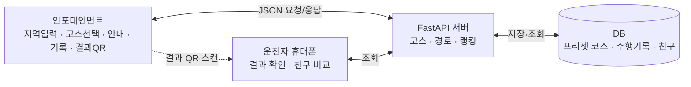

### 데이터가 어디에 있나
| 데이터 | 만드는 곳 | 저장 | 쓰는 곳 |
|---|---|---|---|
| 프리셋 코스(모양·좌표) | 팀이 사전 제작 | DB | 서버 → 인포 목록·지도 |
| 선택한 코스 | 인포 | 주행 기록에 포함 | 서버, 인포 |
| 주행 기록(경로·연비·시간·거리) | 인포 | DB | 인포 결과 화면, 폰 비교 |
| 친구/랭킹 | 서버가 계산 | DB | 폰 |

## 3. 시나리오 (수원 하트 코스)
1. 인포: "어디로 가시겠어요?" → 운전자: "수원"
2. 인포: "수원 근처엔 이런 코스들이 있어요. A. 표범 B. 하트 C. 촛불" (지도 위 모양 미리보기) → 운전자: "B. 하트 코스로 할게"
3. 인포가 지역·코스 선택을 JSON으로 FastAPI에 보내고, 서버가 DB의 프리셋과 알고리즘으로 경로·지도·모양 데이터를 만들어 응답.
4. 인포: "B 경로로 안내합니다." 확인을 누르면 경로 시작점까지 안내(NaviHelper SDK).
5. 추천 경로 위에 처음 진입하면 **기록 시작** (NaviHelper SDK · FusedLocation SDK · Vehicle SDK: 이동 경로, 평균 연비, 주행 시간, 거리).
6. 도착하면 인포 지도 위에 이동 경로와 연비·거리·시간·위치, 시작/종료 타임스탬프를 표시하고 **결과 QR**을 띄움. 기록은 서버에 저장.
7. 스마트폰으로 QR을 찍으면 내 결과 페이지가 열린다(거리·시간·연비·위치·경로).
8. 친구 비교 화면 "11월 드라이브왕": 상단에 내 최고 기록과 1~3위 시상대, 아래 2×2로 연비 부문 / 누적시간 부문 / 주행거리 부문 / 내 최근 기록.

## 4. 흐름도
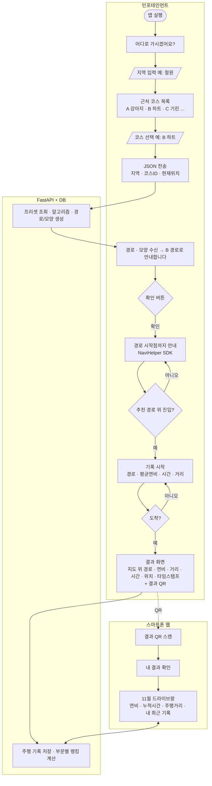

## 5. 시퀀스
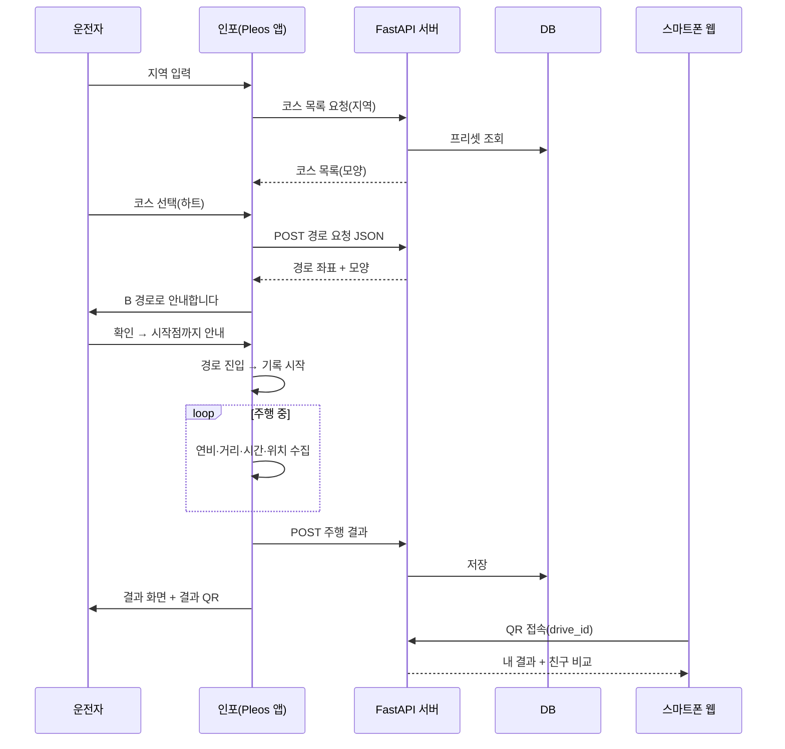

## 6. API 초안
| 호출 | 설명 |
|---|---|
| `GET /courses?region=철원` | 지역 근처 프리셋 코스 목록 |
| `POST /course/route` `{region, course_id, origin}` | 선택한 코스의 경로·모양 데이터 |
| `POST /drive` `{course_id, polyline, avg_fuel_economy, distance_km, duration_sec, started_at, ended_at}` | 주행 결과 저장 → `drive_id` (결과 QR에 포함) |
| `GET /drive/{id}` | 결과 조회 |
| `POST /friends` , `GET /ranking?month=2026-11` | 친구 등록(닉네임+초대코드), 월간 부문별 랭킹(연비·누적시간·주행거리) |

## 7. 결정 사항 / 남은 확인
**결정됨**
- UI 8장은 `/mnt/project-files/scenario/final/`에 있음(수원 하트 코스 예시, 네이버 지도 기반).
- 코스 예시: 표범·하트·촛불(수원).
- 지역 입력~코스 선택~전송은 모두 인포에서 한다. QR은 마지막 결과 공유에만 쓴다.
- 프리셋 코스: 팀이 사전 제작해 DB에 적재.
- 기록 시작: 추천 경로 위에 처음 진입했을 때.
- 결과 화면: 대동차지도 참고(주행거리, 평균 연비, 주행 시간, 이동 경로 + 타임스탬프).
- 인포는 서버에 요청을 보내고 바로 응답을 받는 방식이라 폴링이 필요 없다.

**확인 필요**
1. 친구 식별: 닉네임 + 초대코드(로그인 없음) 제안. 폰에서 닉네임을 입력하고, 방을 만들면 나오는 6자리 코드를 친구가 입력하면 같은 방에서 비교.
2. 연비: Vehicle SDK의 Fuel 도메인("연비 등 연료 관련 정보 조회")에서 가져오는 것이 1순위. 에뮬레이터에서 값이 나오는지 실제 확인 필요. 안 나오면 Odometer(거리)와 연료 정보로 계산하거나 예시 값으로 대체.
3. 지역·코스 선택 입력을 음성으로 할지 터치로 할지(데모는 터치 추천).
4. Pleos 공모전 규정에서 서버(FastAPI) 사용이나 외부 통신에 제한이 있는지.

## 8. Pleos 기술 스택 용어와 제공 상태 (공식 문서 SDK 메뉴 기준, 2026-11-05)
출처: [Pleos Connect SDK 문서](https://document.pleos.ai/docs/pleos-only/connect-sdk-pleos/)

| 우리 기능 | Pleos 공식 모듈 | SDK 메뉴 상태 | 쓰는 방식 |
|---|---|---|---|
| 평균 연비 | **Vehicle State**(Vehicle SDK)의 **Fuel** 도메인 | 사용 가능 | "연비 등 연료 관련 정보 조회", 권한 `pleos.car.permission.CAR_ENERGY`. 전기차는 EvBattery |
| 주행 거리·주행 시간 | **Vehicle State**의 **Odometer** 도메인 | 사용 가능 | 트립 거리·시간, 권한 `pleos.car.permission.CAR_DRIVE` |
| 시작점까지 안내, 코스 경로 안내 | **NaviHelper** SDK | 사용 가능 | 목적지·경유지 설정, 경로 탐색·주행 상태 이벤트(NaviHelperEventListener), 내비게이션 정보 조회. 내비 탑재 차량에서 전체 호환 |
| 이동 경로·현재 위치·시작점 도착 판정 | **FusedLocation** SDK | **Coming Soon** | 권한 `pleos.car.permission.FUSED_LOCATION`, `registerFusedLocationCallback()` |
| 안내 음성 | **TextToSpeech** SDK | **Coming Soon** | 대체안 필요 |
| 음성 지역 입력(옵션) | **SpeechToText** SDK | **Coming Soon** | 데모는 터치 입력으로 확정 |
| 차량 제어 | **Vehicle Control** | **Coming Soon** | 이번 앱은 조회만 사용(영향 없음) |
| 개발·테스트 | Pleos Connect Emulator, Virtual Console | 사용 가능 | AVD: Automotive + Pleos Connect, API 34 |

**지금 확실히 쓸 수 있는 것**: Vehicle State(연비·거리·시간)와 NaviHelper(경로 안내).

**막히는 부분과 대안(확인 필요)**
- 이동 경로·위치 기록: FusedLocation이 Coming Soon. 대안 후보는 NaviHelper가 주는 내비게이션 정보, 또는 Android 표준 위치 API다. 어느 쪽이 에뮬레이터에서 되는지 직접 확인해야 한다. 다른 팀(대동차지도)은 에뮬레이터에서 FusedLocation을 썼다고 적었으므로, 문서의 Coming Soon 표시와 실제 제공 상태가 다를 수 있다.
- 안내 음성: TextToSpeech SDK가 Coming Soon이라 Android 표준 TextToSpeech 사용을 대안으로 검토한다(확인 필요).
- 시나리오의 "시작점 도착 시 기록 시작"과 "지도 위 이동 경로 표시"는 위치 데이터가 있어야 하므로, 위 대안 확인이 먼저다.

**기타 주의점**
- Vehicle SDK 의존성 `ai.pleos.playground:Vehicle:2.3.1`, Maven `https://nexus-playground.pleos.ai/repository/maven-releases/`.
- Vehicle SDK API 지원은 차종별로 다르다. 도메인별 `checkXXXCapabilities`로 확인한다.
- 문서에서 차량 속도 도메인은 확인하지 못했다.
- 서버(FastAPI) 등 외부 통신 제한, 지도 SDK 필요 여부, NaviHelper 권한 이름은 공식 문서에서 확인하지 못했다. 공모전 측 문의 필요(문서 문의처 partnership@pleos.ai).

## 9. UI 화면 (8장)
PDF: [cardnews-1-8.pdf](ui/cardnews-1-8.pdf). 수치·닉네임·안내 문구는 예시이고, 5번은 일러스트다.

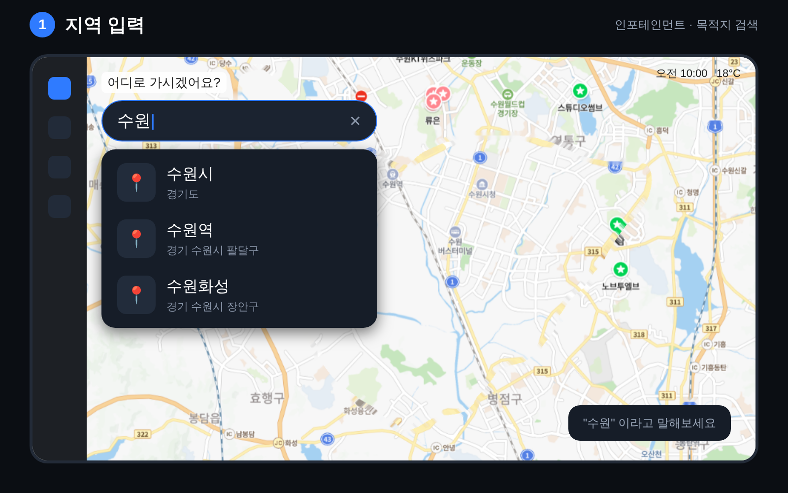
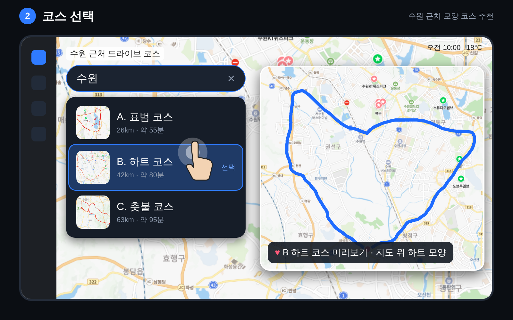
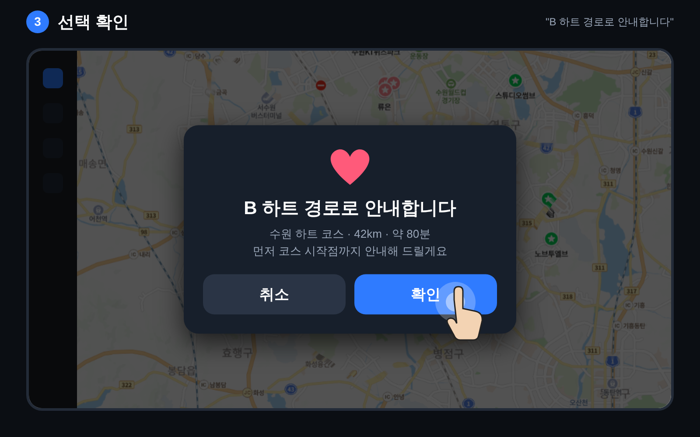
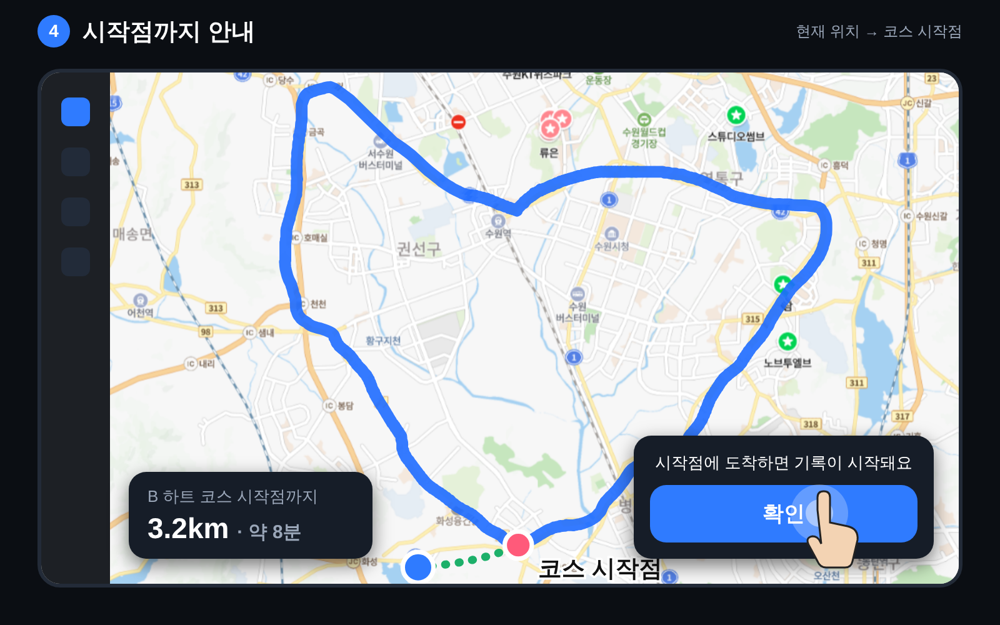
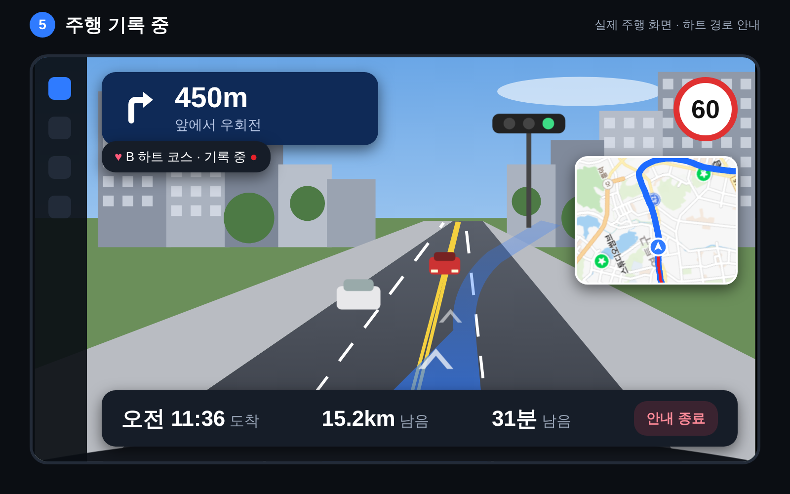
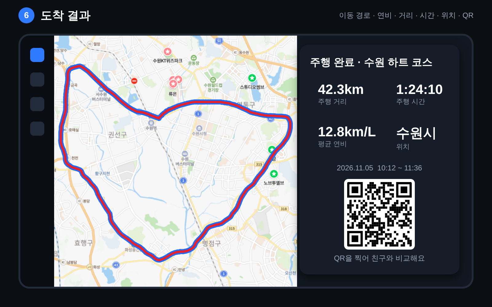
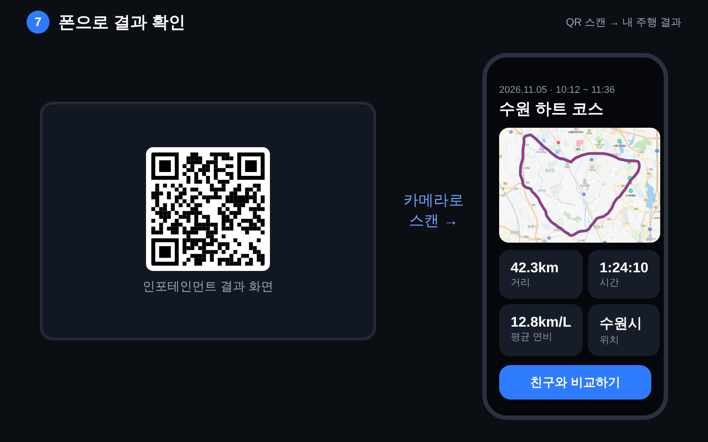
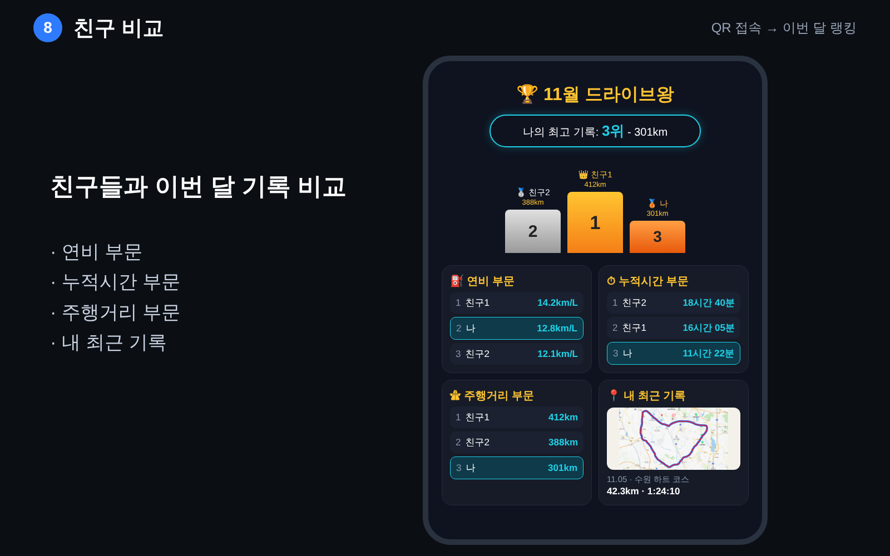
