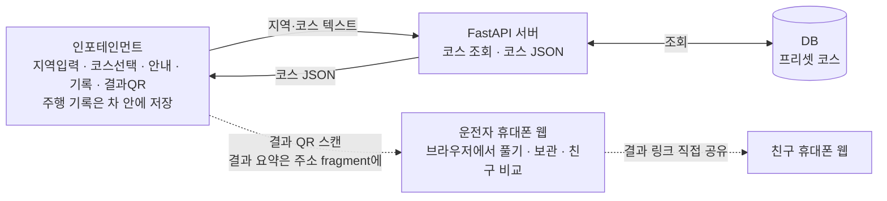
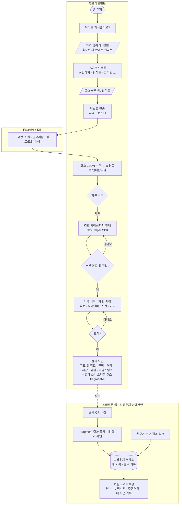
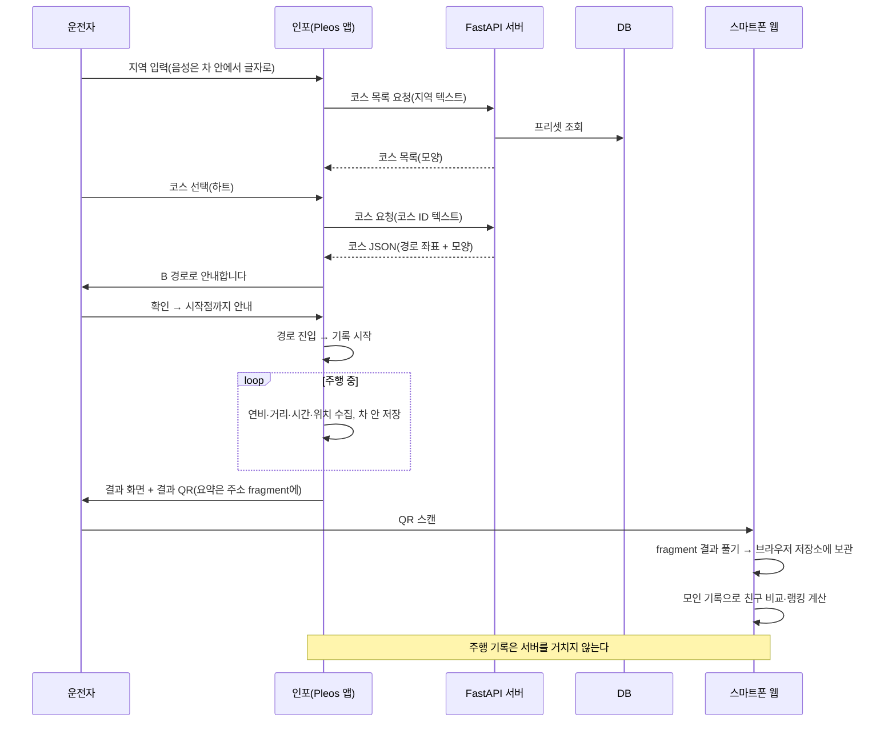

# 시나리오 · 흐름도 (v0.6: 신청서 데이터 처리 원칙 반영)

> **데이터 처리 원칙 (신청서 기준)**: 차량 데이터는 차량 내부에만 저장하고, 서버에는 지역명·모양 이름 같은 텍스트만 보냅니다. 음성 원문은 외부로 보내지 않습니다.
>
> v0.5까지는 주행 기록을 서버 DB에 저장하고 서버가 랭킹을 계산했어요. v0.6부터는 주행 기록을 서버로 보내지 않고, 결과 QR과 폰 브라우저 안에서만 다뤄요.

## 1. 한 줄 요약
인포테인먼트에서 지역 입력과 모양 코스 선택까지 모두 하고, 선택한 코스로 주행·기록한 뒤, **도착 후 결과 QR**을 스마트폰으로 찍어 친구들과 기록을 비교하는 서비스. 주행 기록은 차 안에 남고, 서버는 코스 JSON만 내려 준다.

## 2. 구성요소별 역할
| 구성요소 | 한마디 역할 | 하는 일 | 하지 않는 일 |
|---|---|---|---|
| **인포테인먼트**(Pleos 앱) | 입력·안내·기록·보관 담당 | 지역 입력(음성이면 차 안에서 글자로 변환), 지역·코스 텍스트를 서버에 보내 코스 JSON 받기, 시작점까지 안내(NaviHelper SDK), 주행 기록(위치 + Vehicle SDK Fuel·Odometer, 위치 출처는 8번 참고)과 **차 안 저장**, 결과 화면, 결과 요약을 담은 결과 QR 만들기 | 현재 위치·주행 기록·연비·음성 원문을 서버로 보내기 |
| **운전자 휴대폰**(웹) | 결과 확인·친구 비교 담당 | 결과 QR 스캔, QR 주소 `#` 뒤 결과를 **브라우저 안에서만** 풀어 보여 주기, 받은 기록을 브라우저 저장소에 보관, 친구 기록 받기, 월간 랭킹·연비 대결을 브라우저에서 계산 | 지역 입력, 코스 선택, 안내, 기록을 서버로 보내기 |
| **FastAPI 서버** | 코스 안내 창구 | 지역별 코스 목록 조회, 선택한 코스의 경로·모양 데이터(코스 JSON) 응답 | 주행 기록 수신·저장, 랭킹 계산, 사용자·친구 관리 |
| **DB** | 코스 보관함 | 프리셋 코스(모양·좌표·경유지, 사전 제작) | 주행 기록, 사용자, 친구 관계 저장 |



### 데이터가 어디에 있나
| 데이터 | 만드는 곳 | 저장 | 서버로 가나 | 쓰는 곳 |
|---|---|---|---|---|
| 프리셋 코스(모양·좌표·경유지) | 팀이 사전 제작 | 서버 DB | 서버에 있음 | 서버 → 인포 목록·지도 |
| 지역명·코스 이름(텍스트) | 인포 | 저장 안 함 | **예(텍스트만)** | 서버 코스 조회 |
| 음성 원문(음성 입력을 쓸 때) | 인포 | 저장 안 함 | 아니오 | 차 안에서 글자로 바꾼 뒤 버림 |
| 현재 위치 | 인포(차) | 차 안 | 아니오 | 시작점 안내(차 안 NaviHelper) |
| 주행 기록(경로·연비·시간·거리) | 인포 | **차 안** | 아니오 | 인포 결과 화면, 결과 QR |
| 결과 요약(QR에 담는 값) | 인포 | QR 주소의 `#` 뒤 | 아니오(`#` 뒤는 HTTP 요청에 실리지 않음) | 폰 웹 결과 화면 |
| 내 기록·친구 기록 모음 | 폰 웹 | **폰 브라우저 저장소**(localStorage) | 아니오 | 친구 비교·랭킹 |
| 친구/랭킹 | 폰 웹이 계산 | 폰 브라우저 저장소 | 아니오 | 폰 |

## 3. 시나리오 (수원 하트 코스)
1. 인포: "어디로 가시겠어요?" → 운전자: "수원" (음성이면 차 안에서 글자로 바꾸고 음성 원문은 밖으로 보내지 않는다. 데모는 터치 입력)
2. 인포: "수원 근처엔 이런 코스들이 있어요. A. 표범 B. 하트 C. 촛불" (지도 위 모양 미리보기) → 운전자: "B. 하트 코스로 할게"
3. 인포가 지역·코스 이름(텍스트)만 FastAPI에 보내고, 서버가 DB의 프리셋과 알고리즘으로 만든 경로·모양 데이터(코스 JSON)를 응답. 현재 위치는 보내지 않는다.
4. 인포: "B 경로로 안내합니다." 확인을 누르면 경로 시작점까지 안내(NaviHelper SDK, 현재 위치는 차 안에서만 쓴다).
5. 추천 경로 위에 처음 진입하면 **기록 시작** (NaviHelper SDK · FusedLocation SDK · Vehicle SDK: 이동 경로, 평균 연비, 주행 시간, 거리). 기록은 차 안에 저장.
6. 도착하면 인포 지도 위에 이동 경로와 연비·거리·시간·위치, 시작/종료 타임스탬프를 표시하고 **결과 QR**을 띄움. 기록은 서버로 보내지 않고, 결과 요약을 QR 주소의 `#` 뒤에 담는다(6장).
7. 스마트폰으로 QR을 찍으면 내 결과 페이지가 열린다(거리·시간·연비·위치·경로). 폰 웹이 `#` 뒤 값을 브라우저 안에서 풀어 그리고, 폰 브라우저 저장소에 "내 기록"으로 보관한다.
8. 친구 비교 화면 "11월 드라이브왕": 친구가 보내 준 결과 링크를 열면 "친구 기록"으로 쌓인다. 폰 브라우저가 모인 기록으로 상단에 내 최고 기록과 1~3위 시상대, 아래 2×2로 연비 부문 / 누적시간 부문 / 주행거리 부문 / 내 최근 기록을 계산해 보여 준다(7장).

## 4. 흐름도


## 5. 시퀀스


## 6. API 초안과 결과 QR 형식

### 서버 API (텍스트만 받기)
| 호출 | 설명 |
|---|---|
| `GET /courses?region=철원` | 지역 근처 프리셋 코스 목록 |
| `GET /courses/{course_id}` | 선택한 코스의 경로·모양 데이터(코스 JSON). v0.5의 `POST /course/route {region, course_id, origin}`에서 현재 위치(`origin`)를 뺐다. 시작점까지 가는 길은 차 안 NaviHelper가 찾는다. |

v0.5에 있던 `POST /drive`(주행 결과 저장), `GET /drive/{id}`(결과 조회), `POST /friends`(친구 등록), `GET /ranking?month=`(월간 랭킹)은 **없앤다**. 서버에 주행 기록이 없으므로 `drive_id`도 없다.

### 결과 QR 주소
```
{폰 웹 기본 주소}#r={결과 요약 JSON → deflate 압축 → base64url}
```
- `#` 뒤(fragment)는 브라우저가 HTTP 요청에 싣지 않아서 폰 웹을 내려 주는 정적 서버에도 전달되지 않는다. 폰 웹 JavaScript가 `location.hash`를 읽어 브라우저 안에서 푼다.
- 결과 요약 JSON(현재 `ResultLink.kt`의 `d` 값과 같은 키): `v`(형식 번호), `id`(차가 만든 주행 ID), `course`, `region`, `start`/`end`, `km`, `sec`, `eff`/`unit`, `pl`(경로 요약, 구글 인코딩 폴리라인, 최대 80점).
- 압축: 앱은 `java.util.zip.Deflater`(raw), 웹은 `DecompressionStream('deflate-raw')`. 압축을 안 해도 80점 기준 1천 자 안팎이라 QR에 들어가지만, QR 점이 덜 빽빽해져 차 화면에서 찍기 쉬워진다. 압축 없이 시작해도 된다(`v`로 구분).
- 폰 웹은 `#`을 읽은 뒤 `history.replaceState`로 주소창에서 지워, 브라우저 방문 기록이나 화면 공유로 값이 퍼지지 않게 한다(선택).

## 7. 친구 비교·랭킹을 서버 없이 하는 방법 (검토)

**결론: 데모 범위의 "친구끼리 비교"는 서버 없이 된다. 단, 친구가 결과 링크를 직접 보내 줘야 하고, 기록은 그 폰 브라우저에만 남는다.**

### 흐름
1. 내 결과 QR을 찍으면 폰 웹이 결과를 `localStorage`에 "내 기록"으로 저장한다(차가 만든 `id`로 중복 제거).
2. 처음 쓸 때 닉네임을 폰에만 저장한다. 차는 닉네임을 모른다.
3. 결과 페이지의 "친구에게 보내기"는 `{웹 주소}#r=...&n={닉네임}` 링크를 만든다. 공유는 폰의 공유 기능(Web Share API)이나 링크 복사로, 운전자가 직접 메신저로 보낸다. 친구 폰 화면에 그 링크를 QR로 다시 그려 주는 방법도 있다.
4. 친구가 그 링크를 열면 친구 폰 브라우저에 "친구 기록(닉네임)"으로 쌓인다. 서로 보내면 양쪽 모두 비교할 수 있다.
5. "11월 드라이브왕"은 브라우저에 모인 기록 중 해당 월 것만 골라 연비·누적시간·주행거리 부문 순위와 시상대를 계산한다.

### 어려운 점과 대안
| 어려운 점 | 영향 | 대안 |
|---|---|---|
| 자동으로 모이지 않음 | 친구가 링크를 보내 주지 않으면 랭킹에 안 나온다. "친구 등록 + 6자리 방 코드"로 자동 비교하던 v0.5 방식은 서버가 필요해서 못 쓴다. | 데모는 팀원 폰끼리 미리 링크를 주고받아 둔다. 화면 문구를 "친구가 보낸 기록으로 순위를 매겨요"로 바꾼다. |
| 기록이 그 브라우저에만 있음 | 브라우저 데이터를 지우거나, 시크릿 모드·다른 브라우저·새 폰이면 사라진다. 메신저 안의 브라우저로 열면 저장소가 따로일 수 있다. | "내 기록 내보내기/가져오기"(링크 묶음 또는 JSON 파일), 기본 브라우저로 열기 안내. 데모는 같은 브라우저 사용. |
| 값 위조 가능 | 링크의 값을 손으로 고치면 순위를 속일 수 있다. | 데모는 친구끼리라 허용. 필요하면 앱이 결과에 서명을 붙이고 웹이 확인(앱에 키가 들어 있어 완벽하진 않지만 손 수정은 막는다). |
| 링크 길이 | 메신저가 긴 링크를 자르거나, 메신저 안 브라우저가 `#` 뒤를 지우는지 확인해야 한다. | 압축, 친구용 링크에서는 경로(`pl`) 점 수를 더 줄이기. 실패하면 친구 폰 화면에 QR로 직접 보여 주기. |
| 전체 공개 랭킹 불가 | 모르는 사람까지 포함한 지역·전국 순위는 서버 없이는 못 만든다. | 이번 범위에서 빼고 "친구 랭킹"만 한다. |
| 폰 웹 지도 바탕 | 폰 웹이 외부 지도 타일(예: 네이버 지도)을 불러 경로를 그리면, 타일 요청으로 대략의 주행 지역이 지도 업체에 전달된다. | 지도 없이 선만 그리기(SVG/Canvas), 또는 지도 표시 여부를 팀이 결정. |
| 정적 웹 서버 | 폰 웹 파일을 내려 주는 서버는 여전히 필요하다. 접속 IP 같은 기본 접속 기록은 남는다. | 결과 값은 `#` 뒤라 전달되지 않음을 문서에 적고, 서버 로그에 주소 전체를 남기지 않는다. |

### 신청서의 "공유·커뮤니티" 기능과의 관계
- 운전자가 직접 링크를 보내는 **1:1·친구 공유**는 원칙과 맞는다. 데이터는 우리 서버를 거치지 않고, 운전자가 고른 사람에게만 간다(메신저 같은 외부 서비스는 거친다).
- 여러 사람이 기록을 올리고 모르는 사람의 기록을 보는 **게시판·피드형 커뮤니티**나 **공개 랭킹**은 서버에 주행 기록을 저장해야 해서 원칙과 충돌한다. 신청서의 커뮤니티가 이런 형태라면 아래 중 하나를 팀이 정해야 한다.
  1. 커뮤니티를 "친구에게 링크 공유 + 친구 랭킹"으로 좁혀 설명한다(추천, 지금 구조 그대로).
  2. 운전자가 따로 동의한 경우에만 결과 요약 숫자를 서버에 올리는 선택 기능을 둔다. 이때는 신청서 원칙 문장에 "사용자가 공유를 선택한 결과 요약은 예외"라고 적어야 한다.

## 7-1. 코드에 남은 충돌 (이번 문서 변경에서는 고치지 않음)
| 위치 | 내용 | 바꿀 방향 |
|---|---|---|
| `android/.../ui/result/ResultLink.kt` | 결과를 `?tripId=…&d=…` **쿼리**에 담는다. 쿼리는 폰 웹 서버로 전송된다. | `#r=…` fragment로 옮기기(D·E, 폰 웹 A와 함께) |
| `android/.../ui/state/WebBaseUrl.kt` 주석 | 폰 웹 규격을 `?tripId=...`로 설명 | fragment 형식으로 주석·검사 갱신 |
| `android/.../core/drive/DriveResult.kt` 주석 | "`POST /drive`로 보낸다" | "차 안 저장·QR 요약용"으로 수정(D) |
| `android/.../ui/state/DemoFlowEngine.kt` (`driveResultJson`, 결과 단계 주석) | "서버로 보낼 drive-result JSON", "서버로 보내지 않고 성공 처리" | 업로드 개념 제거, 차 안 저장으로 |
| `android/.../ui/state/ResultState.kt`, `ui/result/ResultScreen.kt`, `FakeUiStates.kt` | `UploadStatus`(보내는 중/실패/다시 보내기), "결과를 보내는 중이에요" 문구 | 업로드 상태 대신 "QR 준비" 상태로(E) |
| `android/.../core/course/CourseRepository.kt` 주석 | 나중에 `GET /courses?near=`(위치로 조회)로 바꾼다고 적힘 | `GET /courses?region=`(텍스트)로 |
| 폰 웹 `web/drive-run-web` (저장소 밖) | `?tripId=&d=`를 읽고 샘플 랭킹 사용 | `location.hash` 읽기, localStorage 보관, 브라우저 랭킹 계산(A) |

## 7-2. 결정 사항 / 남은 확인
**결정됨**
- 데이터 처리는 신청서 원칙을 따른다(맨 위 상자).
- UI 8장은 `/mnt/project-files/scenario/final/`에 있음(수원 하트 코스 예시, 네이버 지도 기반).
- 코스 예시: 표범·하트·촛불(수원).
- 지역 입력~코스 선택~전송은 모두 인포에서 한다. QR은 마지막 결과 공유에만 쓴다.
- 프리셋 코스: 팀이 사전 제작해 서버 DB에 적재. DB에는 코스만 둔다.
- 기록 시작: 추천 경로 위에 처음 진입했을 때.
- 결과 화면: 대동차지도 참고(주행거리, 평균 연비, 주행 시간, 이동 경로 + 타임스탬프).
- 인포는 서버에 요청을 보내고 바로 응답을 받는 방식이라 폴링이 필요 없다.

**확인 필요**
1. 친구 식별: v0.5의 "닉네임 + 6자리 방 코드"는 서버가 필요해 빠진다. 폰에만 저장하는 닉네임 + 링크 공유로 대신할지.
2. 신청서의 공유·커뮤니티 기능을 "친구 링크 공유 + 친구 랭킹"으로 좁혀도 되는지(7장).
3. 폰 웹 결과 화면에 외부 지도 바탕을 쓸지, 선만 그릴지(7장).
4. 연비: Vehicle SDK의 Fuel 도메인("연비 등 연료 관련 정보 조회")에서 가져오는 것이 1순위. 에뮬레이터에서 값이 나오는지 실제 확인 필요. 안 나오면 Odometer(거리)와 연료 정보로 계산하거나 예시 값으로 대체.
5. 지역·코스 선택 입력을 음성으로 할지 터치로 할지(데모는 터치 추천). 음성이면 차 안 인식만 쓴다.
6. Pleos 공모전 규정에서 서버(FastAPI) 사용이나 외부 통신에 제한이 있는지.

## 8. Pleos 기술 스택 용어와 제공 상태 (공식 문서 SDK 메뉴 기준, 2026-11-05)
출처: [Pleos Connect SDK 문서](https://document.pleos.ai/docs/pleos-only/connect-sdk-pleos/)

| 우리 기능 | Pleos 공식 모듈 | SDK 메뉴 상태 | 쓰는 방식 |
|---|---|---|---|
| 평균 연비 | **Vehicle State**(Vehicle SDK)의 **Fuel** 도메인 | 사용 가능 | "연비 등 연료 관련 정보 조회", 권한 `pleos.car.permission.CAR_ENERGY`. 전기차는 EvBattery |
| 주행 거리·주행 시간 | **Vehicle State**의 **Odometer** 도메인 | 사용 가능 | 트립 거리·시간, 권한 `pleos.car.permission.CAR_DRIVE` |
| 시작점까지 안내, 코스 경로 안내 | **NaviHelper** SDK | 사용 가능 | 목적지·경유지 설정, 경로 탐색·주행 상태 이벤트(NaviHelperEventListener), 내비게이션 정보 조회. 내비 탑재 차량에서 전체 호환 |
| 이동 경로·현재 위치·시작점 도착 판정 | **FusedLocation** SDK | **Coming Soon** | 권한 `pleos.car.permission.FUSED_LOCATION`, `registerFusedLocationCallback()` |
| 안내 음성 | **TextToSpeech** SDK | **Coming Soon** | 대체안 필요 |
| 음성 지역 입력(옵션) | **SpeechToText** SDK | **Coming Soon** | 데모는 터치 입력으로 확정 |
| 차량 제어 | **Vehicle Control** | **Coming Soon** | 이번 앱은 조회만 사용(영향 없음) |
| 개발·테스트 | Pleos Connect Emulator, Virtual Console | 사용 가능 | AVD: Automotive + Pleos Connect, API 34 |

**지금 확실히 쓸 수 있는 것**: Vehicle State(연비·거리·시간)와 NaviHelper(경로 안내).

**막히는 부분과 대안(확인 필요)**
- 이동 경로·위치 기록: FusedLocation이 Coming Soon. 대안 후보는 NaviHelper가 주는 내비게이션 정보, 또는 Android 표준 위치 API다. 어느 쪽이 에뮬레이터에서 되는지 직접 확인해야 한다. 다른 팀(대동차지도)은 에뮬레이터에서 FusedLocation을 썼다고 적었으므로, 문서의 Coming Soon 표시와 실제 제공 상태가 다를 수 있다.
- 안내 음성: TextToSpeech SDK가 Coming Soon이라 Android 표준 TextToSpeech 사용을 대안으로 검토한다(확인 필요).
- 시나리오의 "시작점 도착 시 기록 시작"과 "지도 위 이동 경로 표시"는 위치 데이터가 있어야 하므로, 위 대안 확인이 먼저다.

**기타 주의점**
- Vehicle SDK 의존성 `ai.pleos.playground:Vehicle:2.3.1`, Maven `https://nexus-playground.pleos.ai/repository/maven-releases/`.
- Vehicle SDK API 지원은 차종별로 다르다. 도메인별 `checkXXXCapabilities`로 확인한다.
- 문서에서 차량 속도 도메인은 확인하지 못했다.
- 서버(FastAPI) 등 외부 통신 제한, 지도 SDK 필요 여부, NaviHelper 권한 이름은 공식 문서에서 확인하지 못했다. 공모전 측 문의 필요(문서 문의처 partnership@pleos.ai).

## 9. UI 화면 (8장)
PDF: [cardnews-1-8.pdf](ui/cardnews-1-8.pdf). 수치·닉네임·안내 문구는 예시이고, 5번은 일러스트다.


